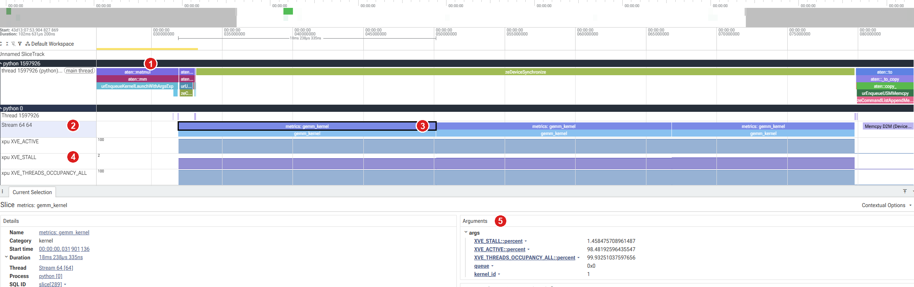
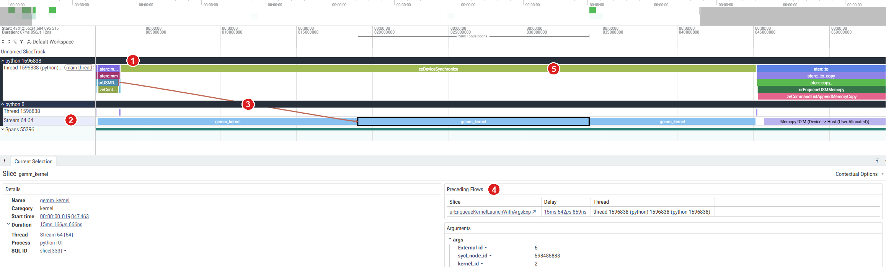

===================================================
Quick Start with the PyTorch Profiler on Intel GPUs
===================================================

On Intel GPUs, the PyTorch profiler (``torch.profiler``) uses PTI as its backend. You get:

.. list-table::
   :header-rows: 1
   :widths: 40 60

   * - What you see
     - What you need
   * - PyTorch operators, runtime and driver calls, GPU kernels and memory copies, with their durations
     - Nothing extra; see `Tracing a PyTorch Script`_
   * - Hardware metrics for each GPU kernel
     - A few setup steps; see `Per-Kernel Hardware Metrics`_

   A matrix multiplication profiled with PyTorch 2.15 on Intel(R) Arc(TM) B-Series Graphics, opened in Perfetto. The CPU activity is in the CPU lane, with one row per CPU thread. The GPU activity is in the GPU lane, with one row per GPU queue and rows for the hardware metrics, if collected. Perfetto calls lanes and rows tracks.

1. **CPU lane**: PyTorch operators (``aten::matmul``, ``aten::mm``) and the calls that launched the kernels.
2. **GPU lane**: the three GPU kernels (``gemm_kernel``) and their durations, then the copy back to the host.
3. **Per-kernel metrics** (``metrics: gemm_kernel``): one event per kernel with its hardware metrics.
4. **Metric counter rows** (``xpu XVE_ACTIVE`` and others): the same metrics as a graph.
5. **Selected event**: click an event to see its values, here the three metrics of the first kernel.

Tracing a PyTorch Script
========================

1. Install PyTorch with Intel GPU (XPU) support, and check that it finds the GPU (prints ``True``):

   .. code-block:: sh

      pip install torch --index-url https://download.pytorch.org/whl/xpu
      python -c "import torch; print(torch.xpu.is_available())"

2. Save this script as ``profile_example.py``:

   .. code-block:: python

      import torch
      from torch.profiler import profile, ProfilerActivity

      a = torch.randn(4096, 4096, device="xpu")
      b = torch.randn(4096, 4096, device="xpu")
      for _ in range(5):
          torch.matmul(a, b)  # warm-up: keep one-time setup out of the profile
      torch.xpu.synchronize()

      acts = [ProfilerActivity.CPU, ProfilerActivity.XPU]
      with profile(activities=acts) as prof:
          for _ in range(3):
              c = torch.matmul(a, b)
          torch.xpu.synchronize()  # wait for the GPU before copying
          c = c.cpu()  # copy the result back to the host

      prof.export_chrome_trace("trace.json")
      print(prof.key_averages().table(sort_by="xpu_time_total", row_limit=10))

3. Run it with ``python profile_example.py``. It prints the CPU and GPU (``XPU``) time of each operator; shortened here to the rows and columns explained below:

   .. list-table::
      :header-rows: 1
      :widths: 34 13 13 13 13 14

      * - Name
        - Self CPU
        - CPU total
        - Self XPU
        - XPU total
        - # of Calls
      * - ``aten::matmul``
        - 5.857 us
        - 3.360 ms
        - 0.000 us
        - 43.178 ms
        - 3
      * - ``aten::mm``
        - 289.385 us
        - 3.354 ms
        - 43.178 ms
        - 43.178 ms
        - 3
      * - ``gemm_kernel``
        - 0.000 us
        - 0.000 us
        - 43.178 ms
        - 43.178 ms
        - 3
      * - ``aten::to``
        - 5.582 us
        - 22.460 ms
        - 0.000 us
        - 20.680 ms
        - 1
      * - ``aten::copy_``
        - 37.828 us
        - 22.426 ms
        - 20.680 ms
        - 20.680 ms
        - 1
      * - ``Memcpy D2M (Device -> Host (User Allocated))``
        - 0.000 us
        - 0.000 us
        - 20.680 ms
        - 20.680 ms
        - 1

   * **Self** columns count an operator's own time; **total** columns add the time of the operators it calls. ``aten::matmul`` calls ``aten::mm``, which launches ``gemm_kernel``.
   * **CPU** columns are host time. GPU operations (``gemm_kernel``, ``Memcpy D2M``) have no CPU time.
   * **XPU** columns are GPU time. ``aten::mm`` launched the kernels itself, so its Self XPU is their 43.178 ms; ``aten::matmul`` launched nothing itself (0) but includes them in its total.
   * **# of Calls**: the script runs three matrix multiplications and one copy.
   * The GPU was busy for 63.858 ms (``Self XPU time total`` under the table): 43.178 ms of kernels (68%) and 20.680 ms of copying (32%).

4. Open ``trace.json`` in Perfetto (https://ui.perfetto.dev, **Open trace file**).

Reading the Trace
=================

   The trace of the example script, with the second ``gemm_kernel`` selected.

1. **CPU lane**: the PyTorch operators (``aten::matmul``, ``aten::mm``) and, under them, the runtime and driver calls they made, including the ones that launch the kernels.
2. **GPU lane**: one row per GPU queue, with the three ``gemm_kernel`` runs and the copy back to the host (``Memcpy D2M``).
3. **Arrow**: links the selected kernel to the call that launched it. Click a kernel to see it.
4. **Preceding Flows**: the delay from launch to start, here 15.6 ms. The CPU launched all three kernels at once, so this one waited for the first to finish.
5. **Waiting for the GPU** (``zeDeviceSynchronize``): ``torch.xpu.synchronize()`` waits until the kernels finish; then ``c.cpu()`` (``aten::to``) copies the result back.

Per-Kernel Hardware Metrics
===========================

Tracing gives each kernel's duration; hardware metrics show how the kernel used the GPU.

Prerequisites
-------------

Check your PTI version with ``pip show intel-pti``:

.. list-table::
   :header-rows: 1
   :widths: 22 16 34 28

   * - PyTorch
     - ``intel-pti``
     - ``ZET_ENABLE_METRICS=1``
     - GPUs that get metrics
   * - 2.14
     - 1.0.1
     - Required
     - The first GPU only
   * - 2.15
     - 1.1.0
     - Required
     - Every GPU the script uses
   * - Later releases
     - 1.2.0 or later
     - Not needed with Intel(R) compute-runtime 25.31.34666.3 or later; required with older drivers (see :doc:`knownissues`)
     - Every GPU the script uses

When it is required, set ``ZET_ENABLE_METRICS=1`` before starting Python:

.. list-table::
   :header-rows: 1
   :widths: 30 70

   * - Shell
     - Command
   * - Linux
     - ``ZET_ENABLE_METRICS=1 python metrics_example.py``
   * - Windows Command Prompt
     - ``set ZET_ENABLE_METRICS=1``, then ``python metrics_example.py``
   * - Windows PowerShell
     - ``$env:ZET_ENABLE_METRICS = "1"``, then ``python metrics_example.py``

On Linux, also:

.. list-table::
   :header-rows: 1
   :widths: 40 60

   * - What
     - How
   * - Install Intel(R) Metrics Discovery and Metrics Library; the GPU driver needs them for metrics but does not install them (on Windows, the graphics driver includes them)
     - Packages ``intel-metrics-discovery`` and ``intel-metrics-library``, from the same source as your GPU driver
   * - Allow metrics for non-root users (lost on reboot)
     - ``echo 0 | sudo tee /proc/sys/dev/xe/observation_paranoid``

       (``/proc/sys/dev/i915/perf_stream_paranoid`` with the ``i915`` kernel module)
   * - Best per-kernel metrics performance (``xe`` kernel module)
     - Intel(R) compute-runtime 26.40.40196.8 or later; older versions add about 2 ms to each kernel

Collecting Metrics
------------------

Add metric names to the XPU activities, save the script as ``metrics_example.py``, and run it as shown in `Prerequisites`_:

.. code-block:: python

   import json

   import torch
   from torch.profiler import profile, ProfilerActivity

   METRICS = ["XVE_ACTIVE", "XVE_STALL", "XVE_THREADS_OCCUPANCY_ALL"]
   # List the XPU activities too; otherwise only kernels are traced.
   XPU_ACTIVITIES = ["CONCURRENT_KERNEL", "GPU_MEMCPY", "GPU_MEMSET",
                     "GPU_USER_ANNOTATION", "XPU_RUNTIME", "XPU_DRIVER",
                     "OVERHEAD"]

   a = torch.randn(4096, 4096, device="xpu")
   b = torch.randn(4096, 4096, device="xpu")
   for _ in range(5):
       torch.matmul(a, b)  # warm-up
   torch.xpu.synchronize()

   acts = [ProfilerActivity.CPU,
           {ProfilerActivity.XPU: XPU_ACTIVITIES + METRICS}]
   with profile(activities=acts) as prof:
       for _ in range(3):
           c = torch.matmul(a, b)
       torch.xpu.synchronize()  # wait for the GPU before copying
       c = c.cpu()  # copy the result back to the host

   prof.export_chrome_trace("trace.json")

   with open("trace.json") as f:
       events = json.load(f)["traceEvents"]
   for event in events:
       if event.get("name", "").startswith("metrics: "):
           print(event["name"], event["args"])

It prints one line per kernel (one of three shown):

.. code-block:: text

   metrics: gemm_kernel {'XVE_STALL::percent': 1.5094707012176514, 'XVE_ACTIVE::percent': 98.4134750366211, 'XVE_THREADS_OCCUPANCY_ALL::percent': 99.91594696044922, 'queue': '0x0', 'kernel_id': 2}

Open ``trace.json`` in Perfetto to see the metrics next to each kernel, as in the first picture on this page.

Interpreting the Metrics
------------------------

.. list-table::
   :header-rows: 1
   :widths: 30 40 15 15

   * - Metric
     - Percentage of time in which...
     - Better when
     - In the example
   * - ``XVE_ACTIVE``
     - at least one pipe of the Xe Vector Engine (XVE) is active
     - Higher
     - 98.4%
   * - ``XVE_STALL``
     - threads are loaded on the XVE but no pipe is active
     - Lower
     - 1.5%
   * - ``XVE_THREADS_OCCUPANCY_ALL``
     - XVE thread slots are occupied (percentage of slots)
     - Higher, usually
     - 99.9%

* The example kernel keeps the vector engines busy.
* A kernel with a low ``XVE_ACTIVE`` or a high ``XVE_STALL`` is a good candidate for optimization.
* For more metrics, and which ones you can collect together, see :doc:`hw_metrics`.

Troubleshooting
===============

.. list-table::
   :header-rows: 1
   :widths: 45 55

   * - Problem
     - Fix
   * - ``torch.xpu.is_available()`` returns ``False``
     - Install the GPU driver, and install PyTorch from the XPU index shown above.
   * - ``RuntimeError`` with ``PTI_ERROR_DRIVER`` (``PTI_ERROR_METRICS_RUNTIME_ENABLE_UNSUPPORTED`` with ``intel-pti`` 1.2.0 or later)
     - Set ``ZET_ENABLE_METRICS=1`` before starting Python (see `Prerequisites`_).
   * - ``RuntimeError`` with ``PTI_ERROR_METRICS_SCOPE_METRIC_NOT_FOUND``
     - A metric name is misspelled or not available on this GPU (see :doc:`hw_metrics`). If every name fails, check that the `Prerequisites`_ are met.
   * - ``RuntimeError`` with ``PTI_ERROR_METRICS_SCOPE_NOT_A_SINGLE_GROUP``
     - The metrics cannot be collected together. Pick metrics from one group; see :doc:`hw_metrics`.
   * - ``RuntimeError`` with ``PTI_ERROR_METRICS_SCOPE_DEVICE_TYPE_NOT_UNIFORM`` (PyTorch 2.15)
     - The system has Intel GPUs of different models, such as an integrated and a discrete GPU. Select GPUs with ``XPUPTI_PROFILER_DEVICES`` (see `Advanced Options`_).
   * - No ``metrics:`` events in ``trace.json``
     - On Linux, check the permission setting in `Prerequisites`_. Make sure no other process collects GPU metrics at the same time.

Advanced Options
================

Put these settings in a text file, one ``KEY=value`` per line, and set the ``KINETO_CONFIG`` environment variable to its path before starting Python:

.. list-table::
   :header-rows: 1
   :widths: 30 50 20

   * - Setting
     - What it does
     - Default
   * - ``XPUPTI_PROFILER_DEVICES``
     - GPUs to collect metrics on, as PTI device indices, for example ``0,1``. They must be the same model. Not in PyTorch 2.14. If all Intel GPUs in the system are discrete (or all integrated) and ``ONEAPI_DEVICE_SELECTOR`` is not set, index N is ``xpu:N``. With integrated and discrete GPUs, PyTorch uses only the discrete ones but PTI counts all of them, so the numbers can differ; check that the trace has ``metrics:`` events.
     - Every GPU the script uses
   * - ``XPUPTI_PROFILER_MAX_SCOPES``
     - Number of kernels the first collection buffer is sized for; PTI adds buffers as needed. Maximum 10000; more raises ``RuntimeError``.
     - 1500
